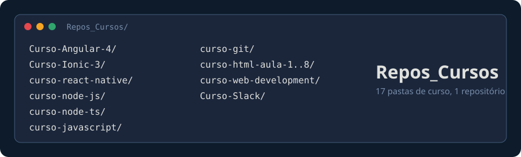
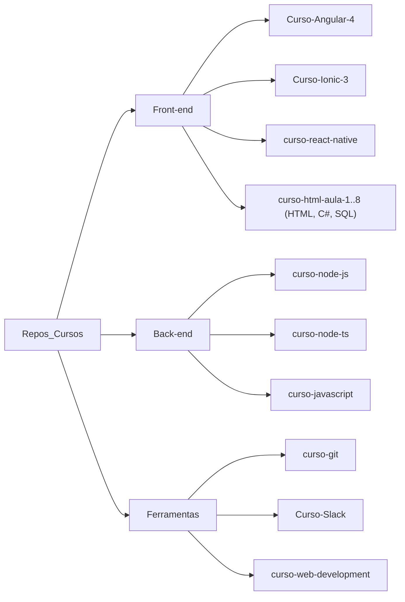

# Repositórios de Cursos

**Coleção de repositórios de cursos e materiais de estudo.** 
17 pastas de curso (Angular, Ionic, React Native, Node.js, JavaScript, Git, HTML, C#, SQL e Slack) num único repositório.

## Sobre

Este repositório agrupa materiais de cursos sobre diversas tecnologias, incluindo Angular, Ionic, React Native, Node.js, JavaScript, Git, HTML, CSS, Slack, e mais.

## Repositórios Inclusos

| Repositório | Tecnologia |
|-------------|------------|
| `Curso-Angular-4/` | Angular 4 (projeto `exemplo/` e API `exemploback/`) |
| `curso-git/` | Git (slides `Git Fatec.pptx`) |
| `curso-html-aula-1/` até `curso-html-aula-4/` | HTML (aulas 2 e 4 com JavaScript) |
| `curso-html-aula-5/` | C# (console .NET Core) |
| `curso-html-aula-6/` | C# / ASP.NET (`Soverteria.sln`) |
| `curso-html-aula-7/` | SQL (`1.sql`, `2.sql`) |
| `curso-html-aula-8/` | C# (`Soverteria.sln`: Web, Console, Dao, Model) |
| `Curso-Ionic-3/` | Ionic 3 |
| `curso-javascript/` | JavaScript |
| `curso-node-js/` | Node.js |
| `curso-node-ts/` | Node.js + TypeScript |
| `curso-react-native/` | React Native |
| `Curso-Slack/` | Slack (tutorial em vídeo, PT-BR) |
| `curso-web-development/` | Web Development (GitHub, JavaScript, SQL) |

As aulas `curso-html-aula-1` a `curso-html-aula-8` são sequenciais; o README da aula 1 lista os links originais de cada uma.

## Como está organizado

## Formato

Cada subdiretório contém o material completo de um curso, incluindo código-fonte, exercícios e anotações.

## Documentação

| Arquivo | Conteúdo |
|---------|----------|
| [`AGENTS.md`](AGENTS.md) | Estrutura do repositório e convenções para agentes |
| [`docs/PROJECT_HEALTH.md`](docs/PROJECT_HEALTH.md) | Automação e guardrails aplicados ao repositório |
| [`SECURITY.md`](SECURITY.md) | Política de segurança |

## Limitações conhecidas

> [!NOTE]
> Não há comando de build ou teste na raiz: cada curso é independente e traz suas próprias instruções (quando existem) no `README` da pasta.

- Vários READMEs de subpasta são genéricos e citam URLs de clone ou scripts `npm` que não existem no projeto; confira o conteúdo da pasta antes de seguir.
- Algumas pastas versionam artefatos de build (`bin/`, `obj/`, `.dll`) e dependem de ferramentas da época do curso (Angular 4, Ionic 3, .NET Core 1.0, Oracle).
- O arquivo `LICENSE` existe apenas em `curso-node-js/`; não há `LICENSE` na raiz.

## Licença

MIT
